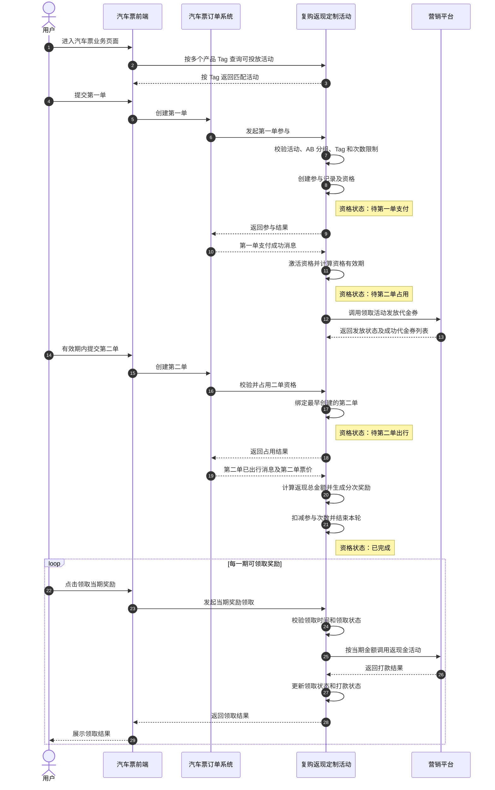
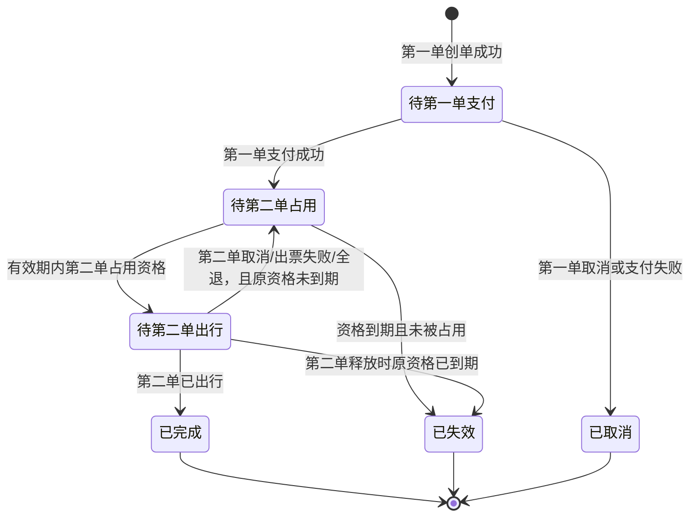

# 1. 文档信息

## 1.1 需求链接

[汽车票复购返现](待补充)

## 1.2 修订历史

| 版本   | 完成时间       | 变更人   | 属性  | 备注                           |
| ---- | ---------- | ----- | --- | ---------------------------- |
| V1.0 | 2026-10-21 | codeX | 新建  | 完成文档信息、需求背景、需求范围和核心流程        |
| V1.1 | 2026-10-21 | codeX | 修改  | 补充资格状态流转图及“已失效”“已取消”状态说明     |
| V1.2 | 2026-10-21 | codeX | 修改  | 新增 5.2 接口与交互清单及详细说明；5.1 留待补充 |
| V1.3 | 2026-10-21 | codeX | 修改  | 4.1 时序图拆分汽车票前端与订单系统职责        |
| V1.4 | 2026-10-21 | codeX | 修改  | 统一业务名称为“复购返现”                 |
| V1.5 | 2026-10-21 | codeX | 修改  | 分次奖励明细新增领取成功后的券号展示          |
| V1.6 | 2026-10-21 | codeX | 修改  | 次数限制合并为可选配置，增加每日维度          |
| V1.7 | 2026-10-21 | codeX | 修改  | 投放限制改为按产品 Tag、AB 分组选配        |
| V1.8 | 2026-10-21 | codeX | 修改  | 基础信息新增必填的多选渠道限制             |
| V1.9 | 2026-10-21 | codeX | 修改  | 前端展示配置改为可选的富文本规则说明          |
| V1.10 | 2026-10-21 | codeX | 修改 | 移除每日次数限制；二单资格新增券包价值配置 |
| V1.11 | 2026-10-21 | codeX | 修改 | 分期领取窗口改为从第二单出行时刻起按连续 24 小时计算 |
| V1.12 | 2026-10-21 | codeX | 修改 | 新增礼包名称、礼包说明与弹窗活动文案；统一礼包配置名称 |
| V1.13 | 2026-10-21 | codeX | 修改 | 参与数据详情增加单期奖励强制流转操作与说明 |
| V1.14 | 2026-10-21 | codeX | 修改 | 收紧产品 Tag、弹窗文案、返现上限与分期配置的输入边界 |
| V1.15 | 2026-10-21 | codeX | 修改 | 活动配置列表的“查看”改为进入只读配置页 |
| V1.16 | 2026-10-21 | codeX | 修改 | 资格有效时长增加输入时的 1～999 整数限制 |
| V1.17 | 2026-10-21 | codeX | 修改 | 返现金额上限收紧至 1～500 元，增加确认输入与中文金额展示 |
| V1.18 | 2026-10-21 | codeX | 修改 | 移除前端展示备注及参与数据页的领取状态筛选、列表列 |
| V1.19 | 2026-10-21 | codeX | 修改 | 活动配置管理增加编辑、复制、操作日志及存量参与快照规则 |
| V1.20 | 2026-10-21 | codeX | 修改 | 优先级限制为 1～9999 的整数，补齐输入与保存校验 |

# 2. 需求背景

汽车票业务希望通过“首单激活二单资格，二单出行后分次返现”的营销方式，引导符合条件的用户在指定时间内完成再次购票和出行，提升汽车票用户的复购与履约。

活动业务名称统一为“复购返现”；“第一单”“第二单”仍用于区分参与轮次中的订单角色，不改变既定资格和返现规则。

当前需要建立一套可按活动、人群、产品 Tag 及参与次数精准投放的复购返现能力，并将首单资格、二单占用、代金券发放、返现奖励生成和用户分次领取串联成完整链路。

本需求期望实现活动的可配置投放、可追踪参与、可分期领取和可核对发放，同时复用营销平台现有的代金券与现金发放能力。

# 3. 需求范围

| 营销系统 | 模块 | 变化类型 | 核心改动 |
|---|---|---|---|
| 复购返现定制活动 | 活动配置与投放 | 新增 | 新增汽车票复购返现活动配置，支持活动时间、优先级、渠道限制、产品 Tag、AB 分组和次数限制。 |
| 复购返现定制活动 | 资格与参与记录 | 新增 | 新增首单创建资格、支付激活、二单占用、出行完成及参与记录查询能力。 |
| 复购返现定制活动 | 活动查询 | 新增 | 支持汽车票业务按多个产品 Tag 查询匹配活动，并按 Tag 返回查询结果。 |
| 复购返现定制活动 | 返现奖励 | 新增 | 新增返现金额计算、分次奖励生成、领取时间管理及领取与打款状态记录。 |
| 营销平台 | 领取活动 | 复用 | 复用现有领取活动，在首单资格激活时发放已关联的多张代金券。 |
| 营销平台 | 返现金活动 | 复用 | 复用绑定动态金额现金商品的返现金活动，承接各期现金发放。 |

# 4. 核心流程

## 4.1 系统交互时序图

## 4.2 流程简述

1. 汽车票业务系统按产品 Tag 实时查询匹配活动，复购返现定制活动按每个 Tag 返回一个查询结果。
2. 用户创建第一单时，定制活动完成参与校验，创建参与记录和“待第一单支付”资格。
3. 定制活动消费第一单支付成功消息，激活资格、计算资格有效期，并复用营销平台领取活动发放代金券。
4. 用户在资格有效期内创建第二单，定制活动将资格与最早创建的符合条件订单绑定。
5. 定制活动消费第二单已出行消息，按活动快照计算返现总金额、生成分次奖励、扣减参与次数，并将资格置为“已完成”。
6. 用户在各期领取时间内主动领取，定制活动按当期金额调用营销平台返现金活动，并记录领取状态与打款状态。

## 4.3 资格状态主链路

`待第一单支付 → 待第二单占用 → 待第二单出行 → 已完成`

| 资格状态   | 状态说明                                                | 是否终态 |
| ------ | --------------------------------------------------- | ---- |
| 待第一单支付 | 第一单已创建参与记录，尚未收到支付成功消息。                              | 否    |
| 待第二单占用 | 第一单已支付且资格已激活，等待有效期内创建第二单。                           | 否    |
| 待第二单出行 | 第二单已占用资格，等待收到已出行消息。占用后不再受原资格截止时间影响。                 | 否    |
| 已完成    | 第二单已出行，分次返现奖励已生成，本轮资格结束。后续领取和打款结果不改变资格状态。           | 是    |
| 已失效    | 资格截止时间已到且没有有效的第二单占用资格，或第二单释放时原资格已到期。                | 是    |
| 已取消    | 第一单在支付成功前取消、支付失败或订单关闭，本次资格结束；后续符合条件的新订单可以重新作为第一单参与。 | 是    |

# 5. 需求说明

## 5.1 后台配置

后台地址：待确认（当前提供本地后台原型）。

### 5.1.1 参与数据页

变化类型：修改。

本次改动：在参与记录详情的“分次返现奖励”明细中，对尚未同时达到“领取成功、打款成功”的单期奖励，增加“强制流转”操作；已同时达到两个成功状态的奖励不展示操作入口。查询区域移除“领取状态”筛选项，参与记录列表移除“领取状态”列；详情中的单期领取状态继续展示。

**分次返现奖励**

| 字段名称 | 展示规则 |
|---|---|
| 强制流转时间 | 未操作时展示“-”；操作后展示后台记录的操作时间，与原领取成功时间分开。 |

**操作**

| 操作名称 | 操作位置 | 权限 | 交互说明 |
|---|---|---|---|
| 强制流转 | 参与记录详情 → 单期奖励行操作 | 独立操作权限待确认 | 点击后展示二次确认；确认后仅将该期领取状态置为`领取成功`、打款状态置为`打款成功`，刷新明细及参与记录汇总领取状态。 |

- 资格和其他期奖励不随此操作变化。原券号与原领取成功时间保持原值；没有真实券号或领取时间时展示“-”，不伪造发放记录。
- 当前原型仅在浏览器本地保存强制流转结果，供交互演示；不会调用真实返现或打款能力。正式后台需按第 12 项接口规则执行。
- 待确认（运营、财务、研发）：允许操作的岗位和审批方式、是否需要填写原因与上传打款凭证、已失效或待生效奖励能否强制流转，以及人工标记“打款成功”与真实资金结果的核对责任。确认前不应将原型按钮视为可直接上线的资金操作。

### 5.1.2 新建活动页

变化类型：修改。

本次改动：对已有字段增加长度、整数与范围校验，将分次领取期数限制为 1～5 期；返现金额上限增加二次确认与中文金额展示，页面输入限制与保存校验保持一致。优先级限定为 1～9999 的整数。前端展示配置模块移除未确认字段的备注提示。

**基础信息**

| 字段名称 | 数据类型 | 页面控件 | 是否必填 | 默认值 | 配置与校验规则 |
|---|---|---|---|---|---|
| 优先级 | 正整数 | 数字输入框 | 是 | 100 | 仅允许输入 1～9999 的整数；数值越大优先级越高。超出范围或非整数时不允许保存，并提示“优先级需为1～9999的整数”。 |

**投放限制**

| 字段名称 | 数据类型 | 页面控件 | 是否必填 | 默认值 | 配置与校验规则 |
|---|---|---|---|---|---|
| 产品 Tag | 字符串 | 单行文本输入框 | 条件必填 | 无 | 勾选产品 Tag 投放限制后必填；整段输入内容（含分隔符）最多 100 个字符，多个 Tag 以英文逗号分隔。超出时提示“产品Tag输入内容最多100字符”。 |

**二单资格配置**

| 字段名称 | 数据类型 | 页面控件 | 是否必填 | 默认值 | 配置与校验规则 |
|---|---|---|---|---|---|
| 资格有效时长 | 正整数 | 数字键盘单行输入框 | 是 | 24 小时 | 仅允许 1～999 的整数，单位为小时；输入时拒绝非整数、前导零和超范围内容，保存时再次校验，不符合时提示“资格有效时长需为1～999的整数小时”。 |

**返现配置**

| 字段名称 | 数据类型 | 页面控件 | 是否必填 | 默认值 | 配置与校验规则 |
|---|---|---|---|---|---|
| 返现金额上限 | 正整数 | 数字键盘单行输入框 | 是 | 30 元 | 输入时仅允许 1～500 的整数，单位为元；右侧实时展示对应中文数字金额，如“30”展示为“三十元”。保存时再次校验，不符合时提示“返现金额上限需为1～500的整数”。 |
| 确认返现金额上限 | 正整数 | 数字键盘单行输入框 | 是 | 无 | 输入时仅允许 1～500 的整数；必须与返现金额上限相等才能保存，不一致时提示“确认返现金额上限与返现金额上限不一致”。该字段仅用于保存确认，不作为活动配置保存；查看活动时不展示。 |

**分次领取配置**

| 字段名称 | 数据类型 | 页面控件 | 是否必填 | 默认值 | 配置与校验规则 |
|---|---|---|---|---|---|
| 期数 | 正整数 | 添加一期、删除按钮 | 是 | 3 期 | 最少 1 期、最多 5 期；达到 5 期后不可继续添加，剩余 1 期时不可删除。 |
| 单期返现比例 | 正整数 | 数字输入框 | 是 | 第 1～3 期分别为 30%、30%、40% | 每期仅允许 1～100 的整数，单位为 %；各期合计必须为 100%。 |
| 领取开始时间 | 非负整数 | 数字输入框 | 是 | 第 1～3 期分别为 1、4、7 天 | 仅允许 0～99 的整数，单位为出行后天数。 |
| 领取结束时间 | 非负整数 | 数字输入框 | 是 | 第 1～3 期分别为 3、6、10 天 | 仅允许 0～99 的整数，且不得早于本期领取开始时间。 |

**前端展示配置**

| 字段名称 | 数据类型 | 页面控件 | 是否必填 | 默认值 | 配置与校验规则 |
|---|---|---|---|---|---|
| 弹窗活动文案 | 字符串 | 单行文本输入框 | 否 | 无 | 最多 100 个字符，超出时提示“弹窗活动文案最多100字符”。 |

### 5.1.3 活动配置管理页

变化类型：修改。

本次改动：列表行支持查看、编辑、日志、复制。有效活动允许编辑；编辑沿用原活动 Code。复制进入预填的新建页，保存时生成新活动 Code。

**操作**

| 操作名称 | 操作位置 | 权限 | 交互说明 |
|---|---|---|---|
| 查看 | 活动配置列表行操作 | 活动查看权限待确认 | 按活动 Code 打开配置页；展示活动 Code 和已保存的各项配置，所有表单控件及富文本区域不可修改，不提供保存按钮；点击“返回列表”回到活动配置管理页。 |
| 编辑 | 活动配置列表行操作 | 活动编辑权限待确认 | 有效、无效活动均可进入编辑页，展示原活动 Code 且不可修改；预填已保存配置，修改后按新增页规则校验，返现金额上限须重新确认。保存覆盖该 Code 的当前配置，不创建新 Code；配置未变更时提示无需保存。 |
| 复制 | 活动配置列表行操作 | 活动新增权限待确认 | 打开预填配置的新建页；活动名称在原名称后添加“复制”（受活动名称 40 字符上限约束），投放时间、状态及其他配置一并复制，均可在保存前调整；返现金额上限须重新确认。保存时生成新 Code，不修改原活动。 |
| 日志 | 活动配置列表行操作 | 活动日志查看权限待确认 | 弹窗展示该活动的创建、编辑、复制操作记录，包含操作时间、操作类型、操作人和变更内容；编辑记录按字段列出修改前后值，复制记录关联新活动 Code。历史示例活动无操作记录时展示“暂无日志”。 |

- 若活动 Code 对应的配置不存在，页面提示“未找到该活动配置”，不允许提交，并提供返回列表入口。
- 编辑活动仅影响后续新第一单参与。已有参与的资格及奖励继续按参与时保存的配置快照执行；次数限制仍按既定的实时配置口径校验。复制活动在保存前不产生新 Code，也不影响原活动及其参与记录。
- 原型没有后台登录态，操作人固定显示“原型操作员（演示）”，日志仅存于当前浏览器本地。正式实现须从登录态取得真实操作人，并由服务端持久化不可篡改的操作记录；历史活动不补造日志。

## 5.2 接口与交互

本节以复购返现定制活动为主要承接系统。营销平台的领取活动、返现金活动复用现有 `participate` 能力；汽车票业务系统提供订单创建及状态变更信息。下列定制活动接口名称为业务名称，正式接口名、路径和字段名以研发接口定义为准。

### 5.2.1 接口与交互清单

| 序号  | 接口/交互        | 类型          | 调用方       | 接收方      | 变化类型 | 说明                               |
| --- | ------------ | ----------- | --------- | -------- | ---- | -------------------------------- |
| 1   | 按产品 Tag 查询活动 | API         | 汽车票业务系统   | 复购返现定制活动 | 新增   | 页面展示时按多个 Tag 查询，每个 Tag 返回一个匹配结果。 |
| 2   | 第一单创单参与      | API         | 汽车票业务系统   | 复购返现定制活动 | 新增   | 第一单创单时校验活动与账号参与资格，创建待支付资格。       |
| 3   | 第二单创单占用资格    | API         | 汽车票业务系统   | 复购返现定制活动 | 新增   | 后续订单创单时检查并占用已激活的二单资格。            |
| 4   | 汽车票订单状态变更    | MQ          | 汽车票业务系统   | 复购返现定制活动 | 新增   | 消费订单消息，处理第一单支付与取消、第二单释放与已出行等事件。  |
| 5   | 二单资格到期处理     | 定时任务        | 定制活动任务调度  | 复购返现定制活动 | 新增   | 关闭到期且未被第二单占用的资格。                 |
| 6   | 分次返现奖励领取     | API         | 汽车票业务系统   | 复购返现定制活动 | 新增   | 用户主动领取单期奖励，定制活动调用营销平台返现金活动。      |
| 7   | 订单活动记录详情查询   | API         | 汽车票业务系统   | 复购返现定制活动 | 新增   | 按第一单或第二单查询当前登录账号的活动进度与奖励明细。      |
| 8   | 参与记录后台查询     | API         | 营销后台      | 复购返现定制活动 | 新增   | 供运营查询参与记录、资格、发券和返现明细。            |
| 9   | 分次奖励过期处理     | 定时任务        | 定制活动任务调度  | 复购返现定制活动 | 新增   | 关闭超过领取截止时间仍未领取的单期奖励。             |
| 10  | 活动配置新增、编辑、复制与查询 | API | 营销后台 | 复购返现定制活动 | 新增 | 保存及变更活动配置，复制时生成新 Code，并供管理页查询。 |
| 11  | 现金打款状态同步     | 待确认（API/MQ） | 营销平台或商品中心 | 复购返现定制活动 | 待确认  | 将现金商品发放后的实际打款结果同步到单期奖励记录。        |
| 12  | 单期奖励强制流转     | API         | 营销后台      | 复购返现定制活动 | 新增   | 运营在参与记录详情中确认后，对单期奖励的领取与打款状态进行人工流转。 |
| 13  | 活动配置操作日志查询 | API | 营销后台 | 复购返现定制活动 | 新增 | 按活动 Code 查询创建、编辑、复制记录及字段变更。 |

### 5.2.2 接口与交互详细说明

##### 1. 按产品 Tag 查询活动

参数：

- 入参：产品 Tag 列表。每个 Tag 的值为产品 code；账号、人群判断所需信息及具体字段结构以研发接口定义为准。
- 返参：与输入 Tag 一一对应的结果；包含原 Tag 和匹配的活动信息。无匹配活动时保留该 Tag，活动信息为空。

逻辑说明：

- 对每个 Tag 独立查询当前有效且处于投放时间内的活动，并校验已配置的产品 Tag、AB 分组等投放条件。此接口仅用于前端展示，不创建资格，也不占用参与次数。未配置产品 Tag 时的查询匹配范围待业务确认。
- 多个活动命中同一 Tag 时，优先级数值越大越优先；优先级相同时，更新时间越近越优先。每个 Tag 最多返回一个活动。
- 查询实时读取活动配置。活动在查询后发生变化，不影响创单环节重新校验的结果。
- 待确认（业务与研发）：渠道限制是否参与活动查询、渠道值的入参来源，以及接口正式名称、账号及 AB 分组信息的来源、返回结构和无匹配结果的字段表达；影响前后端联调。

##### 2. 第一单创单参与

参数：

- 入参：当前登录账号、第一单订单号及创建时间、单个活动 Code（与活动 ID 为同一标识）、单个产品 Tag。订单与账号的身份信息由汽车票业务系统提供，字段名待研发确定。
- 返参：是否参与成功、参与记录及资格标识、未参与原因；字段结构待研发确定。

逻辑说明：

- 判断活动及投放条件。判断逻辑：以下条件均须满足。
  - 活动 Code 对应的配置有效，第一单创建时间位于活动投放时间内。
  - 已配置产品 Tag 时，传入 Tag 须与配置值完全匹配；已配置 AB 分组时，账号须满足对应分组。未选中的投放限制不参与该项校验。
  - 账号未处于本轮有效资格中，且按活动最新配置实时校验可选的每人每月参与次数限制；次数归属第一单创建月份，次数限制不进入资格快照。
- 如果满足条件，创建参与记录，记录活动配置快照，并使资格进入`待第一单支付`。仅有第一单创单不会发券或扣减参与次数。
- 如果不满足条件，返回不参与；订单仍按业务自身流程处理。当前订单已作为第二单占用其他资格时，不得同时作为本轮第一单。
- 同一订单重复调用不得创建多条资格；并发创单须保证同一账号同一时刻只存在一个进行中的有效资格。已取消的首单记录保留，后续新订单可重新校验参与。
- 待确认（业务与研发）：渠道限制是否在首单创单时重新校验、订单渠道值的来源，以及正式接口名称、创单与资格创建的调用时点及失败回执方式；影响订单与定制活动的一致性联调。

##### 3. 第二单创单占用资格

参数：

- 入参：当前登录账号、第二单订单号及创建时间；用于预计返现的票价之和由汽车票业务系统提供，字段结构待研发确定。
- 返参：是否占用成功、对应第一单及资格标识、资格状态、预计返现总金额；字段结构待研发确定。

逻辑说明：

- 判断可占用资格。判断逻辑：账号存在`待第二单占用`资格，且第二单创建时间位于该资格原有效期内。该订单必须晚于第一单创建，且不能用已占用其他二单权益的订单作为第一单。
- 满足条件时，按创单时间最早的符合条件订单占用资格，绑定第二单订单号，状态变更为`待第二单出行`。该次占用不消耗新的活动参与次数。
- 占用后原资格截止时间不再影响已绑定订单出行返现；第二单取消、出票失败或全退后的释放规则见第 4 项。
- 多个第二单并发创单时只允许一个占用成功；同一订单重复调用返回原占用结果。未占用的订单不写入该轮二单记录。
- 如返回预计返现，应以当前二单票价及活动快照中的返现比例、上限计算；实际金额以已出行时上游提供的票价为准。
- 待确认（研发）：并发创单的先后顺序判定依据，以及出票环节前能否取得预计票价；影响预计金额展示和并发验收。

##### 4. 汽车票订单状态变更

参数：

- Topic：汽车票订单状态变更消息的正式 Topic 待汽车票业务系统确认。
- 关键消息信息：订单号、账号、订单状态、状态发生时间；第二单已出行事件还需提供该单票价之和及精确到秒的出行时间。字段名及票价口径以业务系统消息定义为准。

逻辑说明：

- 第一单支付成功：仅处理`待第一单支付`资格，状态变更为`待第二单占用`；以支付成功时间加配置的 X 小时计算原资格截止时间，同时调用营销平台领取活动 `participate` 发放该轮代金券。每轮只调用一次；记录整体发放状态及成功发放的奖品名称、状态、券号。发券失败仅记录，由客诉线下处理，不阻塞资格激活。
- 第一单取消、支付失败或关闭：若仍为`待第一单支付`，状态变更为`已取消`。第一单支付成功后不再因其后续订单状态撤销资格或追回代金券。
- 第二单取消、出票失败或全退：若该订单占用资格且尚未已出行，则释放占用，保留历史订单流水；原截止时间未到时返回`待第二单占用`，已到时进入`已失效`。不延长原资格有效期。
- 第二单已出行：若处于`待第二单出行`且与当前占用订单一致，计算实际返现总金额并生成分次奖励，使资格变为`已完成`，扣减已配置的参与次数；每月维度计入第一单创建月。第二单已出行视为终态，之后的订单状态不改变已完成资格或追回奖励。
- 返现总金额按`向下取整(min(第二单票价之和 × 返现比例，返现金额上限))`计算，单位为元。各期比例之和为 100%；前 N－1 期分别按总额乘比例向下取整，不足 1 元的当期金额为 0 且不生成可领取奖励；最后一期为总金额减去前 N－1 期金额之和。例如票价 37 元、比例 50%、上限 15 元、分期 30%/30%/40%，总额为 15 元，各期为 4、4、7 元。
- 每期领取窗口以第二单出行时刻 T 为基准，按连续 24 小时计算，不按自然日切分：开始时刻为 T＋X×24 小时（含），结束时刻为 T＋（Y＋1）×24 小时（不含）。例如 T 为 10 月 17 日 08:00:00、配置第 1～3 天，则窗口为 10 月 18 日 08:00:00（含）至 10 月 21 日 08:00:00（不含）。统一按北京时间展示时刻；窗口允许重叠，各期独立，单期过期仅该期失效。
- 消费订单消息须以订单及事件去重，并校验当前资格状态和绑定关系；重复或乱序事件不得重复发券、生成奖励、扣减次数或释放已完成资格。
- 待确认（汽车票业务系统与研发）：正式 Topic、消息字段、支付失败和出票失败事件的状态枚举、精确到秒的出行时间来源与票价口径；影响消息消费、领取窗口计算和金额验收。

##### 5. 二单资格到期处理

逻辑说明：

- 定时扫描原截止时间已到、状态仍为`待第二单占用`的资格，将其变更为`已失效`；已占用并处于`待第二单出行`的资格不得因原截止时间到来而失效。
- 第二单创单接口也须实时校验原截止时间，避免任务执行间隔内继续占用过期资格。
- 批次更新须按资格状态和截止时间再次校验，重复执行不重复变更；任务失败后可在下批继续扫描未处理资格。
- 待确认（研发）：执行频率、批次大小、扫描延迟目标和运维告警阈值；影响过期状态展示及时性。

##### 6. 分次返现奖励领取

参数：

- 入参：当前登录账号、活动参与记录及单期奖励标识；字段名和认证方式以研发接口定义为准。
- 返参：该期领取状态、现金商品发放状态及可确认的打款状态、领取成功后的券号、领取结果；字段结构待研发确定。

逻辑说明：

- 判断可领取奖励。判断逻辑：资格状态为`已完成`，该期奖励金额不少于 1 元，当前时间位于该期领取窗口内，且该期未领取、未失效。
- 用户主动点击领取后，定制活动按该期金额调用营销平台返现金活动 `participate`。返现金活动须绑定支持动态金额的现金商品；定制活动记录该期领取状态及调用结果，不改变已完成资格。
- 领取成功时记录该期返现奖励对应的券号；后台参与记录详情在“打款状态”后展示“券号”列。未领取或领取失败的期次展示“-”。此券号与首单激活时发放的代金券券号分别记录。
- 每期独立领取，顺序不限。超过当期结束时间且未领取的奖励只使本期失效，不改变其他期金额或领取窗口。
- 同一期重复点击或请求重放不得重复调用返现；已记录的发放失败只记录状态，本需求不进行自动重试或客诉补发。
- 正常领取链路中，现金商品发放成功不等于实际打款成功。打款状态只有获得营销平台或后续打款链路的明确结果后才可标记成功；人工强制流转另按第 12 项记录来源，不得混同为自动打款结果。
- 待确认（营销平台、商品中心与研发）：动态金额入参的正式字段、返现奖励券号的来源与返回字段、发放结果与最终打款状态的获取方式和状态枚举、调用超时后的结果查询方式；影响领取结果、券号及打款状态准确性。

##### 7. 订单活动记录详情查询

参数：

- 入参：当前登录账号、单个订单号；订单属于第一单或第二单，由定制活动查询参与关系确定。字段名以研发定义为准。
- 返参：无记录或活动记录；活动记录包含活动 ID（即活动 Code）、订单角色、第一单与第二单信息、二单资格状态及有效期、当前占用第二单号、预计与实际返现总金额、奖励状态、成功发放的代金券列表及分次返现进度。

逻辑说明：

- 仅允许当前登录账号查询本人名下的订单活动记录。未命中参与记录时返回无活动记录；已取消的参与记录仍可返回。
- 使用第一单或第二单查询均返回所属轮次的完整进度。第一单详情只展示当前占用的第二单，不展示历次已释放订单。
- 代金券仅返回实际发放成功的列表；发放失败时列表为空。每张券包含奖品名称、发放状态、券号。分次奖励分别展示领取状态、打款状态及领取成功后的券号。
- 展示依据参与时保存的活动配置快照；参与次数限制按当前配置判断，不从快照读取。
- 待确认（研发）：同一订单跨已完成轮次的关联选择和“订单角色”的返参枚举；影响历史记录查询口径。

##### 8. 参与记录后台查询

参数：

- 查询条件：用户账号、活动 Code、第一单订单号、第二单订单号、资格状态；分页字段以后台接口定义为准。
- 列表返回信息：参与记录号、活动 Code、用户账号、第一单、当前第二单、资格状态及有效期、预计与实际返现、发券状态、更新时间。详情仍返回资格、代金券和分次奖励明细，其中单期奖励包含领取状态。

逻辑说明：

- 按已生成的参与记录查询；已取消和已失效记录仍可查询。详情返回资格状态、当前占用订单、参与配置快照、成功发放的代金券明细及每期奖励的领取状态、打款状态与券号。
- 后台不支持人工补发或修改资格状态；仅允许按第 12 项对单期奖励执行强制流转。
- 待确认（研发及运营权限方）：分页与排序、数据权限和敏感账号展示规则；影响后台验收与上线权限配置。

##### 9. 分次奖励过期处理

逻辑说明：

- 定时扫描当前时间已达到该期领取结束时刻、且仍未领取的单期奖励，将该期领取状态置为`已失效`。结束时刻为第二单出行时刻加（Y＋1）×24 小时，采用不含边界；不再以自然日 23:59:59 为截止时间。
- 各期独立处理；一笔奖励过期不增加其他期金额，不改变其他期的时间范围，也不回退`已完成`的资格状态。
- 处理前再次校验该期当前状态与截止时间；用户领取与过期任务并发时，仅允许其中一个状态变更成功。重复执行不重复变更，任务失败后由下一批继续扫描。
- 待确认（研发）：执行频率、批次大小、扫描延迟目标和运维告警阈值；影响页面上过期状态的更新及时性。

##### 10. 活动配置新增、编辑、复制与查询

参数：

- 新增入参：活动名称、投放时间及状态、优先级、必填的渠道限制（支持多选：微信主小程序 852、同程 APP 安卓 434、同程 APP IOS 433、鸿蒙 APP 10212）、选配的投放限制（产品 Tag、AB 实验分组）、可选的每人每月参与次数限制、二单资格时长、礼包名称、礼包说明、礼包价值、礼包发券活动 Code、返现比例和上限、返现金活动 Code、各期比例与领取时间，以及非必填的单行弹窗活动文案、富文本规则说明。字段名以研发定义为准。
- 新增返参：保存结果、自动生成的活动 Code（即活动 ID）。
- 编辑入参：原活动 Code 及待保存的完整配置；Code 不可修改。返参为保存结果和原 Code。
- 复制入参：来源活动 Code 及预填后可调整的完整配置；名称默认追加“复制”，投放时间、活动状态和其他字段默认沿用来源配置。返参为保存结果和新生成的活动 Code。
- 查询入参：活动名称、活动 Code、活动状态；详情按活动 Code 查询。分页字段以后台接口定义为准。
- 查询返参：活动配置列表及完整详情；字段结构以研发定义为准。

逻辑说明：

- 新增保存时自动生成唯一活动 Code，不要求运营手工填写。渠道限制至少选择一个渠道，并保存所选渠道代码。优先级须为 1～9999 的整数。投放限制先选择维度，再展示对应配置项；选择产品 Tag 时至少填写一个 Tag，且整段输入内容最多 100 个字符；选择 AB 实验分组时填写实验编号和可参与分组。校验活动时间、资格时长、礼包字段、返现比例、返现上限及分次比例合计；每人每月参与次数限制非必填，未选择即不限制，选择后次数须为 1～99 的整数。礼包名称必填，去除首尾空格后为 1～10 个字符；礼包说明必填，去除首尾空格后为 1～100 个字符；礼包价值必填，须为 1～999 的整数。返现金额上限须为 1～500 的整数，确认输入也须为 1～500 的整数且与上限一致；确认值不作为配置保存。分次领取配置 1～5 期，单期返现比例须为 1～100 的整数，领取开始与结束时间均须为 0～99 的整数且结束不得早于开始。
- 礼包名称、礼包说明、礼包价值和礼包发券活动作为活动配置保存并在配置详情展示；礼包价值是否需要与实际发券面额核对，待业务确认。
- “前端展示配置”包含非必填的单行“弹窗活动文案”和富文本“规则说明”；弹窗活动文案最多 100 个字符。后台原型支持规则说明的基础文字格式和列表；保存及展示时仅保留允许的排版标签，不接受脚本、样式或内嵌内容。两个字段未填写时配置详情显示“未配置”。
- 待确认（业务与研发）：弹窗活动文案与规则说明由哪个前端接口返回、展示时点、是否进入参与配置快照，以及活动配置变更后使用实时配置还是快照；影响前端展示与接口字段设计。
- 列表支持按活动名称、Code、状态查询；“查看”按活动 Code 进入只读配置页，不提供保存入口；“编辑”允许有效活动修改，原 Code 保持不变；“复制”打开预填新建页，保存时才生成新 Code。列表展示更新时间。编辑后的当前配置仅用于后续新第一单参与；已生成资格与返现奖励依已记录的快照执行，次数限制按最新配置校验。
- 创建、编辑、复制成功后记录真实操作人、时间、操作类型及变更内容；编辑日志保留字段修改前后值，复制日志关联来源 Code 与新 Code。历史记录无日志时返回空列表，前端显示“暂无日志”，不补造记录。
- 保存与查询操作应遵循营销后台权限控制；复制和新增的重复提交不能意外创建多条活动，编辑应校验并发版本以避免覆盖他人修改。正式编码规则、唯一性约束、权限名和并发控制方式待研发确认。

##### 11. 现金打款状态同步

参数：

- 待确认：关联单期奖励与现金商品发放记录的标识、打款结果及发生时间、结果来源和传输方式。

逻辑说明：

- 领取活动调用返回的现金商品发放结果仅可用于记录商品发放状态，不得直接推断实际打款成功。
- 正常领取链路中，若营销平台或商品中心提供最终打款结果，由定制活动按关联标识更新对应单期奖励的打款状态；重复结果不重复处理，结果晚于用户领取响应时，详情查询展示最新已确认状态。人工强制流转须另行记录来源，不能伪装为自动打款结果。
- 待确认（营销平台、商品中心与研发）：是否存在可复用的打款结果 API、MQ 或回调，正式状态枚举及查询权限。若无可用结果源，正常领取链路只能展示“待确认/未知”等真实状态，不能展示虚构的“打款成功”；人工强制流转仍需第 12 项的核账与审计规则，此项影响打款状态展示的验收范围。

##### 12. 单期奖励强制流转

参数：

- 入参：参与记录标识、单期奖励标识；操作人身份从后台登录态获取。正式字段名、是否需要操作原因和核账凭证待研发与运营确认。
- 返参：操作结果、更新后的单期领取状态与打款状态、强制流转时间；字段结构待研发确定。

逻辑说明：

- 判断可操作奖励：单期奖励存在，且领取状态与打款状态未同时为`领取成功`、`打款成功`。若两者均已成功，返回无需处理，不重复流转。
- 操作前展示二次确认；确认后原子更新该期领取状态为`领取成功`、打款状态为`打款成功`，记录操作人、操作时间、原状态和状态来源，并重新汇总参与记录的领取状态。不得改变其他期、资格状态、奖励金额或领取窗口。
- 此接口是营销记录的人工状态流转，不应触发营销平台 `participate` 或真实资金打款；没有真实券号和领取成功时间时保持空值，不得生成虚构值。并发或重复请求须保证同一期只成功流转一次，记录可追溯。
- 待确认（运营、财务、研发）：是否必须先完成线下发放或核账才能标记“打款成功”、权限与审批、操作原因及凭证要求、已失效或待生效期次的可操作范围，以及后续自动打款结果与人工状态冲突时的优先级。以上事项影响正式接口与资金对账验收。

##### 13. 活动配置操作日志查询

参数：

- 入参：活动 Code；分页参数及查询权限以后台接口定义为准。
- 返参：操作时间、操作类型（创建／编辑／复制）、真实操作人、变更字段及修改前后值；复制操作同时返回来源活动 Code 与新活动 Code。按操作时间倒序返回。

逻辑说明：

- 创建、编辑或复制成功后，与配置保存结果关联写入操作记录；保存失败或仅打开页面不记日志。编辑记录应能追溯每个变更字段的原值与新值，复制记录应能追溯原活动和新活动，不以当前配置反推历史内容。
- 无记录时返回空列表，管理页展示“暂无日志”；历史示例活动不补造操作人或操作时间。正式实现从后台登录态获取操作人，日志在服务端持久化并限制修改或删除。
